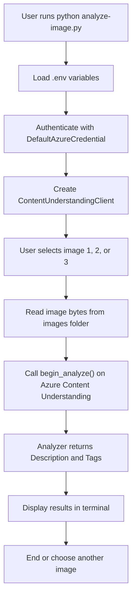

# Azure Content Understanding Image Analyzer

## Project name explanation

This project is called the Azure Content Understanding Image Analyzer because it uses Microsoft Azure's Content Understanding service to analyze image files and extract meaningful metadata, such as:

- a human-readable description of the image
- relevant tags or keywords
- structured output from a custom analyzer created in Azure AI Foundry / Content Understanding Studio

In short, the solution combines:

- Azure Content Understanding for AI-based analysis
- Python for application logic
- a custom analyzer for image understanding
- Azure identity for secure authentication

## What this project does

This sample Python app lets you select one of three sample images and send it to an Azure Content Understanding analyzer.

The analyzer processes the image and returns structured fields such as:

- Description
- Tags

The application then prints the results in the terminal.

This is useful for scenarios like:

- organizing image libraries
- generating searchable metadata
- enriching digital asset catalogs
- building AI-powered visual search and indexing workflows

## Folder overview

- `analyze-image.py` — Python app that connects to Azure Content Understanding and analyzes images
- `requirements.txt` — required Python packages
- `.env` — local environment settings for the Azure endpoint and analyzer name
- `images/` — sample image files used for testing

## Flowchart



## Tools and Azure services used

### Azure services

- Azure AI Foundry
  - Used to create and manage the project and AI resources.
- Azure Content Understanding
  - The main AI service used to analyze images and generate structured metadata.
- Azure Content Understanding Studio
  - Used to build and publish the custom image analyzer.
- Azure Storage Account
  - Used to support the project assets and content in the Azure AI Foundry resource setup.
- Azure Identity / Microsoft Entra authentication
  - Uses `DefaultAzureCredential` for secure login without hardcoding secrets.

### Developer tools and SDKs

- Python
  - Runtime used for the sample application.
- Azure CLI (`az login`)
  - Used to sign in to Azure from the terminal.
- `azure-ai-contentunderstanding`
  - Python SDK for connecting to Azure Content Understanding.
- `azure-identity`
  - Provides Azure authentication support.
- `python-dotenv`
  - Reads environment variables from the `.env` file.

## Project architecture

The app follows a simple client-to-AI architecture:

1. The Python script loads configuration values from `.env`.
2. It authenticates to Azure using `DefaultAzureCredential`.
3. It creates a `ContentUnderstandingClient` pointing to the Azure Content Understanding endpoint.
4. It reads a local image file and sends it to the configured analyzer.
5. Azure Content Understanding returns generated description and tag metadata.
6. The app prints the results to the console.

## Setup

### 1. Configure environment variables

Create or update the `.env` file in this folder with values similar to:

```env
ENDPOINT=https://<your-foundry-resource-name>.services.ai.azure.com/
ANALYZER=<your-analyzer-name>
```

Important notes:

- Use the Azure Content Understanding resource endpoint, not an OpenAI endpoint.
- `ANALYZER` should match the analyzer name you created in Content Understanding Studio.

### 2. Install dependencies

```bash
pip install -r requirements.txt
```

### 3. Sign in to Azure

```bash
az login
```

### 4. Run the app

```bash
python analyze-image.py
```

Then choose one of the sample images:

- 1: giraffe
- 2: elephant
- 3: lion

## Example output

```text
Analyzing with my-image-analyzer analyzer...
  File: images/image1.jpg

Description:
A close-up of a giraffe standing in a natural landscape.

Tags:
  - giraffe
  - animal
  - wildlife
  - grassland
```

## Use cases

This folder is a good example of how to:

- connect a Python app to Azure AI services
- call a custom content analyzer
- process image data using AI-generated metadata
- build lightweight search and classification features on top of Azure AI

## Summary

This project demonstrates the power of Azure Content Understanding for structured image analysis. It uses a modern Azure AI workflow to convert unstructured image content into useful metadata that can be consumed by search, indexing, and data processing applications.

## License

This project is part of the Microsoft Learn AI Vision learning content and follows the repository license used by the parent project.
