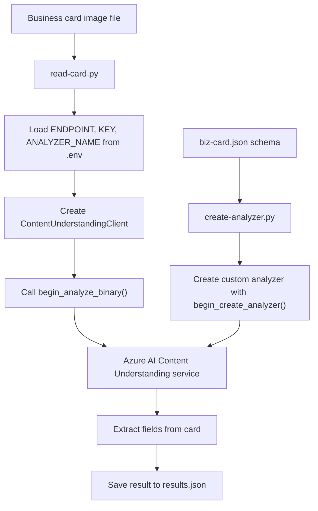

# Business Card Information Extraction with Azure Content Understanding

## Project name explanation

This project is a sample Python application for extracting structured contact details from a business card image using Azure AI Content Understanding.

The name reflects the main goal of the solution:

- Business Card: the source document is a scanned business card image
- Information Extraction: the system reads and extracts key fields such as name, title, phone, email, and company
- Azure Content Understanding: the Azure AI service used to analyze the image and recognize relevant content

In short, this project turns an image of a business card into structured JSON data that can be used in CRM, contact management, or automation workflows.

---

## What this project does

This folder contains a simple end-to-end example that performs the following steps:

1. Reads a business card schema from a JSON definition file
2. Creates a custom Azure Content Understanding analyzer using that schema
3. Sends a business card image to the analyzer
4. Extracts structured fields from the card
5. Saves the result as a JSON file

The sample files included here are:

- create-analyzer.py: creates the custom analyzer for the business card
- read-card.py: analyzes the uploaded business card image
- biz-card.json: schema describing the fields to extract
- biz-card-1.png and biz-card-2.png: sample business card images
- requirements.txt: Python package dependencies
- .env: local environment variables for endpoint, key, and analyzer name

---

## Project workflow

### High-level flow



### Step-by-step flow

1. The custom analyzer schema is defined in biz-card.json.
2. The application reads the schema and creates an analyzer in Azure Content Understanding.
3. The business card image is submitted to the analyzer for processing.
4. The Azure service identifies fields such as:
   - Company
   - Name
   - Title
   - Email
   - Phone
5. The result is returned as structured data and written to results.json.

---

## Azure services and tools used

### Azure services

- Azure AI Content Understanding
  - Main service used to process the business card image
  - Uses a custom analyzer definition to extract structured fields
- Azure AI Services / Microsoft Foundry resource
  - Provides the endpoint and authentication key used by the Python SDK
  - Hosts the Content Understanding service

### Development tools and libraries

- Python
  - Main programming language for the sample
- Azure SDK for Python
  - azure.ai.contentunderstanding
  - azure.core.credentials
- python-dotenv
  - Loads environment variables from the .env file
- JSON schema
  - Defines the fields the analyzer should extract

### Runtime configuration

The app expects these environment variables in a .env file:

- ENDPOINT
- KEY
- ANALYZER_NAME

Example:

```env
ENDPOINT=https://<your-resource>.services.ai.azure.com/
KEY=<your-api-key>
ANALYZER_NAME=businesscardanalyzer
```

---

## Folder structure

```text
02-content-understanding-api/
├── .env
├── biz-card-1.png
├── biz-card-2.png
├── biz-card.json
├── create-analyzer.py
├── read-card.py
├── requirements.txt
├── README.md
└── results.json   (generated after analysis)
```

---

## How to run the project

### 1. Install dependencies

```bash
pip install -r requirements.txt
```

### 2. Configure environment variables

Create or update the .env file with your Azure resource connection details.

### 3. Create the analyzer

```bash
python create-analyzer.py
```

This creates a custom analyzer using the schema in biz-card.json.

### 4. Analyze a business card image

```bash
python read-card.py biz-card-1.png
```

The script sends the image to Azure Content Understanding and saves the result to results.json.

---

## Example output fields

After analysis, the application prints extracted fields such as:

- Company
- Name
- Title
- Email
- Phone

Example JSON structure:

```json
{
  "contents": [
    {
      "fields": {
        "Company": { "value": "Contoso" },
        "Name": { "value": "Jane Smith" },
        "Title": { "value": "Sales Manager" },
        "Email": { "value": "jane@contoso.com" },
        "Phone": { "value": "+1 (425) 555-0100" }
      }
    }
  ]
}
```

---

## Why this project matters

This sample demonstrates how Azure AI Content Understanding can be used to transform unstructured documents into structured, actionable business data. It is especially useful for:

- Contact capture from business cards
- CRM data entry automation
- Document digitization workflows
- Intelligent document processing scenarios

---

## Summary

This folder is a practical example of a custom Azure AI Content Understanding workflow for business card data extraction. It combines:

- Azure AI Content Understanding
- Python SDK clients
- A custom JSON schema
- A local business-card image input
- Structured JSON output

It is a clear, beginner-friendly example of how AI-based document understanding can automate information extraction.
