# Gen AI Vision

This project demonstrates a simple Python app that combines text and image input in a chat experience powered by Azure AI Foundry and an Azure OpenAI multimodal model.

The app asks the user for a question, sends an image along with the prompt, and receives a natural-language answer from the model. In this lab, the image is a fruit photo, and the model responds like a helpful grocery-store assistant.

## Project name explanation

The name Gen AI Vision combines two ideas:

- Gen AI: Generative AI, which creates or reasons about content using large language and multimodal models.
- Vision: The ability for the model to understand images as part of the prompt, not just plain text.

Together, this project shows how generative AI can interpret an image and answer questions about it.

## What this app does

- Loads configuration from a local `.env` file
- Signs in to Azure with `DefaultAzureCredential`
- Uses an Azure OpenAI endpoint and deployed model
- Sends a prompt plus an image to a multimodal model
- Prints the model response in the terminal

This is a lightweight sample for learning how to build a vision-enabled AI chat app with Azure.

## Folder contents

- `image-chat-app.py` - Main Python application logic
- `requirements.txt` - Required Python packages
- `.env` - Local environment settings for the Azure endpoint and model deployment
- `mystery-fruit.jpeg` - Sample local image used for testing

## Flowchart

```mermaid
flowchart LR
    A[User enters question] --> B[Python app loads .env settings]
    B --> C[Azure CLI login via az login]
    C --> D[DefaultAzureCredential gets Azure token]
    D --> E[OpenAI SDK connects to Azure OpenAI endpoint]
    E --> F[Model receives prompt + image]
    F --> G[Azure AI Foundry / Azure OpenAI model responds]
    G --> H[Response is shown in terminal]
```



## Tools and technologies used

### Python tools

- Python 3.13+
- VS Code
- OpenAI Python SDK
- `python-dotenv` for environment variables
- `azure-identity` for Azure authentication

### Azure services used

- Azure AI Foundry project
- Azure OpenAI service
- Model deployment such as `gpt-5.2`, `gpt-5.2-mini`, or `gpt-4o`
- Azure CLI authentication with `az login`

### Why these services matter

- Azure AI Foundry organizes the project, model deployment, and Azure resources.
- Azure OpenAI provides the model endpoint used by the application.
- `DefaultAzureCredential` allows the app to authenticate securely without hardcoding secrets.
- The OpenAI SDK enables multimodal requests that include both text and image content.

## Configuration

The app expects the following values in `.env`:

```env
ENDPOINT=https://{your-foundry-resource-name}.openai.azure.com/openai/v1/
MODEL_DEPLOYMENT=gpt-5.2
```

> The endpoint should be the Azure OpenAI endpoint, not the Foundry project endpoint.

## Setup

1. Sign in to Azure:

```bash
az login
```

2. Install dependencies:

```bash
pip install -r requirements.txt
```

3. Run the app:

```bash
python image-chat-app.py
```

4. Enter a question, such as:

```text
What is this fruit? What recipes could I use it in?
```

5. Type `quit` to exit the program.

## Example usage

The app can send either:

- a public image URL, or
- a local image file converted to a base64 data URL

This makes it possible to test image analysis using real fruit photos and natural-language prompts.

## Learning outcome

This project introduces the key concepts behind multimodal generative AI apps:

- AI model access through Azure services
- Secure authentication with Microsoft identity
- Sending image + text to a model
- Building a simple interactive AI experience in Python

## Notes

This sample is designed for learning and experimentation. It does not include advanced conversation memory or a full production application architecture.
