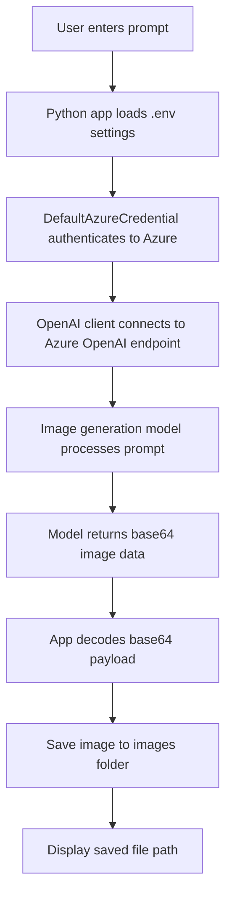

# Image Client - Azure OpenAI Image Generation

This project is a simple Python client that connects to Azure OpenAI and generates images from text prompts. It sends a prompt to a deployed image-generation model, receives the generated image as base64 data, decodes it, and saves it as a PNG file in the local `images` folder.

## Project name explanation

### Image Client
The name reflects the role of the application:

- It acts as a client application.
- It connects to Azure-hosted AI services.
- It sends user prompts for image generation.
- It receives responses and saves outputs locally.

The main implementation lives in [image-client.py](image-client.py), and the configuration is stored in [.env](.env).

---

## What this project does

The application:

1. Reads configuration values from the `.env` file.
2. Signs in to Azure using `DefaultAzureCredential`.
3. Authenticates to Azure OpenAI using the service endpoint.
4. Sends the user prompt to the configured model deployment.
5. Receives the generated image.
6. Decodes the returned `b64_json` payload.
7. Saves the image as a `.png` file.

---

## Flowchart



---

## Tools and libraries used

This project uses the following tools and Python libraries:

- Python 3
- Visual Studio Code
- Azure CLI (`az login`)
- Python-dotenv for loading environment variables
- Azure Identity for secure Azure authentication
- OpenAI Python SDK for calling the Azure OpenAI API
- Requests for HTTP interactions
- Base64 for decoding the image payload

### Dependency file
The dependencies are listed in [requirements.txt](requirements.txt).

---

## Azure services used here

### 1. Azure OpenAI
This is the main service used to generate images from text prompts.

- The app connects to the Azure OpenAI endpoint.
- It sends a model deployment name, such as a GPT-image model.
- The service returns the generated image in base64 format.

### 2. Azure Identity
The project uses Azure Identity to authenticate securely without hardcoding secrets.

- `DefaultAzureCredential` is used.
- The user signs in with Azure CLI using `az login`.
- The app requests the required token for `https://cognitiveservices.azure.com/.default`.

### 3. Azure AI Foundry / Azure Portal configuration
This project assumes the Azure resource is configured in Azure AI Foundry / Azure OpenAI, where:

- the endpoint is defined,
- the model deployment is created,
- the resource is accessed by the application.

---

## Project structure

```text
python/
├── .env
├── image-client.py
├── requirements.txt
└── images/
    └── generated image files (.png)
```

---

## How to run

1. Open the project folder in VS Code.
2. Update the values in [.env](.env) with your Azure OpenAI endpoint and model deployment name.
3. Install dependencies:

```bash
pip install -r requirements.txt
```

4. Sign in to Azure:

```bash
az login
```

5. Run the client:

```bash
python image-client.py
```

6. Enter a prompt such as:

```text
Create an image of a robot eating pizza
```

7. The generated image will be saved in the `images` folder.

---

## Example output

The app saves images with names like:

```text
image_1.png
image_2.png
```

These files are stored in the local `images` directory under the project folder.

---

## Summary

This folder contains a lightweight Azure AI image-generation sample that demonstrates how to:

- authenticate to Azure securely,
- call an Azure OpenAI image model,
- receive generated image data,
- decode and store the result locally.

It is a great example of a practical client-side integration with Azure AI services.
