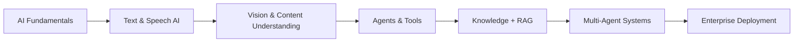
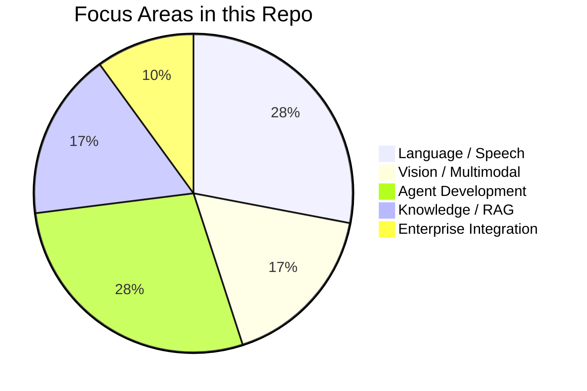
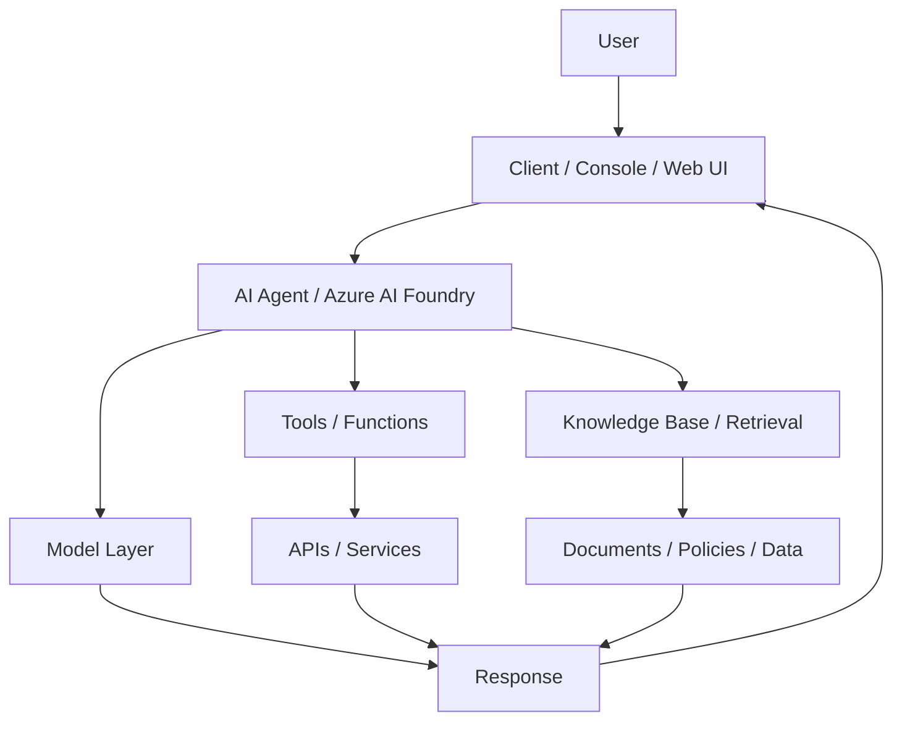

# AI-103 Capstone Projects Repository

This repository contains a curated collection of hands-on AI projects completed as part of the Microsoft AI-103 training path. The work focuses on building practical Generative AI, Azure AI, and agent-based solutions using Microsoft tools and services such as Azure AI Foundry, Azure OpenAI, Azure AI Language, Azure AI Speech, Microsoft Content Understanding, and agent orchestration patterns.

The projects demonstrate a progression from foundational prompt-based AI and vision/speech scenarios to advanced multi-agent, knowledge-grounded, and enterprise-integrated experiences.

## Repository at a glance

- Repository: `Saranraj-k/AI-103`
- Focus: Microsoft AI-103 coursework and capstone projects
- Primary technologies: Python, Azure AI, Microsoft Foundry, OpenAI models, speech, vision, RAG, document intelligence
- Project style: Labs, demos, app prototypes, and agent solutions

## Learning journey

This repo is organized as a practical journey through modern AI engineering:

## Project categories

| Category | Description | Representative projects |
|---|---|---|
| Language and Speech | Text analysis, speech transcription, synthesis, translation, voice interfaces | [Text Analysis with Azure AI Language](./Text%20Analysis%20with%20Azure%20AI%20Language), [Azure AI Speech Voice Mail](./Azure%20AI%20Speech%20Voice%20Mail), [Speech-Enabled Generative AI Projects](./Speech-Enabled%20Generative%20AI%20Projects) |
| Vision and Multimodal AI | Image generation, image understanding, analysis, and visual reasoning | [Gen AI Vision](./Gen%20AI%20Vision), [Image Client - Azure OpenAI Image Generation](./Image%20Client%20-%20Azure%20OpenAI%20Image%20Generation), [Azure Content Understanding Image Analyzer](./Azure%20Content%20Understanding%20Image%20Analyzer) |
| Agentic AI | Building custom agents, function calling, tool use, and MCP integration | [IT SUpport agent with Microsoft foundry](./IT%20SUpport%20agent%20with%20Microsoft%20foundry), [MCP Integration Lab](./MCP%20Integration%20Lab), [Multi Agent RAG](./Multi%20Agent%20RAG) |
| Enterprise Knowledge & RAG | Grounding models with policy docs, brochures, and internal knowledge | [Travel APP with Microsoft foundry](./Travel%20APP%20with%20Microsoft%20foundry), [Business Card Information Extraction with Azure Content Understanding](./Business%20Card%20Information%20Extraction%20with%20Azure%20Content%20Understanding), [agent RAG](./agent%20RAG) |
| Workflow and Orchestration | Combining multiple specialized agents and end-to-end processing | [Azure Speech Agent Console Client](./Azure%20Speech%20Agent%20Console%20Client), [Azure Voice Live Chat Client](./Azure%20Voice%20Live%20Chat%20Client), [Text Analysis Agent with Microsoft Foundry](./Text%20Analysis%20Agent%20with%20Microsoft%20Foundry) |

## Project catalog

| Project | Summary | Key capabilities |
|---|---|---|
| [Astronomy Observation Assistant](./Astronomy%20Observation%20Assistant) | A knowledge-backed agent experience around astronomy and observation related tasks. | Agent design, tools, grounding, assistant workflows |
| [Azure AI Speech Voice Mail](./Azure%20AI%20Speech%20Voice%20Mail) | Demonstrates a voice mail and speech-processing workflow using Azure AI Speech services. | Speech-to-text, text processing, voice-driven automation |
| [Azure Content Understanding Image Analyzer](./Azure%20Content%20Understanding%20Image%20Analyzer) | Uses Azure Content Understanding to analyze and extract insights from images. | Image analysis, metadata extraction, content understanding |
| [Azure Speech Agent Console Client](./Azure%20Speech%20Agent%20Console%20Client) | Console-based client for interacting with speech-enabled AI agents. | Client app integration, speech APIs, conversational UX |
| [Azure Voice Live Chat Client](./Azure%20Voice%20Live%20Chat%20Client) | Voice-first live chat client for real-time interaction with AI. | Streaming chat, speech interaction, live client design |
| [Business Card Information Extraction with Azure Content Understanding](./Business%20Card%20Information%20Extraction%20with%20Azure%20Content%20Understanding) | Extracts structured business card data from images using Azure AI document understanding patterns. | OCR, field extraction, structured data conversion |
| [Gen AI Vision](./Gen%20AI%20Vision) | Explores image understanding and AI-driven visual conversation. | Visual QA, image prompt workflows, multimodal AI |
| [IT SUpport agent with Microsoft foundry](./IT%20SUpport%20agent%20with%20Microsoft%20foundry) | An IT support agent built with Microsoft AI Foundry and enterprise-style knowledge. | Agent reasoning, policy-driven support, business workflows |
| [Image Client - Azure OpenAI Image Generation](./Image%20Client%20-%20Azure%20OpenAI%20Image%20Generation) | Image generation application using Azure OpenAI. | Prompt-driven generation, client integration, image output |
| [MCP Integration Lab](./MCP%20Integration%20Lab) | Practicum for Model Context Protocol (MCP) integrations between components and tools. | MCP server/client architecture, tool connectivity |
| [Multi Agent RAG](./Multi%20Agent%20RAG) | Multi-agent retrieval-first setup with knowledge retrieval and orchestrated responses. | Agent routing, RAG pipelines, multi-step reasoning |
| [Speech-Enabled Generative AI Projects](./Speech-Enabled%20Generative%20AI%20Projects) | Collection of speech-centric GenAI use cases including transcription and synthesis. | TTS, STT, translation, speech workflows |
| [Text Analysis Agent with Microsoft Foundry](./Text%20Analysis%20Agent%20with%20Microsoft%20Foundry) | Text-focused agent scenario using Microsoft Foundry capabilities. | Agents, tool use, text understanding |
| [Text Analysis with Azure AI Language](./Text%20Analysis%20with%20Azure%20AI%20Language) | Demonstrates sentiment, key phrase, and language analysis with Azure AI Language services. | Text mining, NLP, sentiment, summarization |
| [Travel APP with Microsoft foundry](./Travel%20APP%20with%20Microsoft%20foundry) | Travel assistant and knowledge app grounded in curated travel data and brochures. | RAG, workflows, brochure retrieval, grounded answers |
| [agent RAG](./agent%20RAG) | Agent-centered retrieval architecture for retrieving and answering questions from knowledge stores. | Retrieval grounding, conversational search, agent QA |

## What I learned across the projects

The projects together cover the main themes of AI product development in the AI-103 learning path:

- Building AI apps with Azure AI and OpenAI services
- Designing speech-enabled and multimodal experiences
- Creating grounded responses using retrieval and knowledge sources
- Integrating tools and custom logic into agent workflows
- Building multi-agent orchestration patterns
- Applying enterprise concepts such as policy-grounded responses and knowledge recall
- Prototyping solutions that are ready for future extension into production environments

## Typical solution architecture

## Skills demonstrated

| Skill area | Examples from this repo |
|---|---|
| Prompt design and model interaction | AI chat demos, built-in model playground workflows |
| Azure AI services | Speech, Language, Content Understanding, OpenAI integration |
| Agent design | Function calling, tools, orchestration, custom clients |
| Retrieval-Augmented Generation | Travel app, enterprise knowledge projects, agent RAG |
| Document and image intelligence | Business card extraction, image analysis |
| Voice interfaces | Speech mail, live chat, translation, transcription |
| Enterprise app scenarios | IT support agent, M365/knowledge integration patterns |

## Suggested order to explore

1. Start with [Text Analysis with Azure AI Language](./Text%20Analysis%20with%20Azure%20AI%20Language)
2. Explore [Speech-Enabled Generative AI Projects](./Speech-Enabled%20Generative%20AI%20Projects)
3. Review [Gen AI Vision](./Gen%20AI%20Vision) and [Image Client - Azure OpenAI Image Generation](./Image%20Client%20-%20Azure%20OpenAI%20Image%20Generation)
4. Move to [IT SUpport agent with Microsoft foundry](./IT%20SUpport%20agent%20with%20Microsoft%20foundry)
5. Study [MCP Integration Lab](./MCP%20Integration%20Lab) and [Multi Agent RAG](./Multi%20Agent%20RAG)
6. Finish with enterprise-style and travel-grounded knowledge apps such as [Travel APP with Microsoft foundry](./Travel%20APP%20with%20Microsoft%20foundry)

## Notes

- The repository is intentionally structured as a learning portfolio and practical implementation space.
- Several projects include lab instructions, sample datasets, and code assets that are designed for experimentation and extension.
- Most solutions are Python-based and designed to be adapted to Azure AI services, local experimentation, or further enterprise deployment.

## Summary

This repository represents a full-spectrum exploration of Generative AI and Azure AI capabilities through Microsoft AI-103 coursework. It progresses from text, speech, and vision AI fundamentals to intelligent agents, enterprise knowledge integration, and multi-agent orchestration. The result is a strong portfolio of practical AI solutions that combine technical implementation with applied business and user experience thinking.

---

Built as part of the Microsoft AI-103 learning journey.
